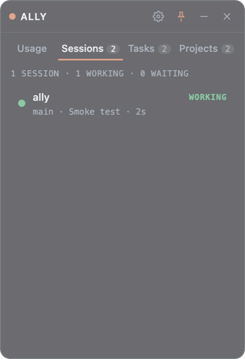
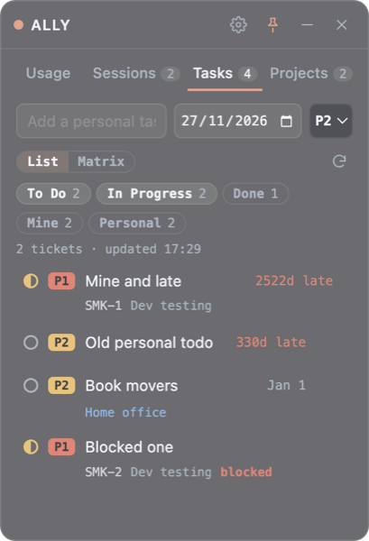
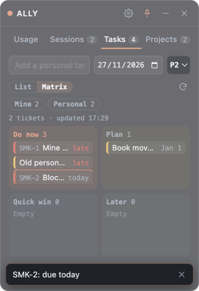
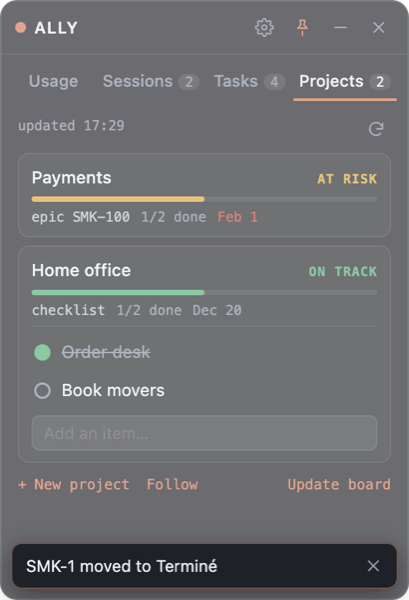

# Ally

**A small always-on-top companion for Claude Code.** See every session at a glance, answer
its questions without switching windows, and keep your tasks and Jira tickets in sight
while you work. Linux, macOS and Windows.

  
  
  
  

## What it does

- **Sessions.** Every running Claude Code session, its folder, branch and state: working,
  idle, or waiting for you. Click one to jump to its terminal tab.
- **Answers.** When a session asks a question or a permission, Ally pops up with the
  options. Answer there; your terminal keeps its focus.
- **Tasks.** Personal todos, and your Jira tickets if you want them, in one list or in an
  urgent × important matrix. Drag a task to another square to change its priority or due date.
- **Plan with Claude.** One click opens a terminal with Claude already briefed on the
  ticket, in the right repository.
- **Projects.** Progress of Jira epics, labels or your own checklists, with a board you can
  open on claude.ai.
- **Usage.** Today's tokens and replies, and, if you turn it on, your plan's 5-hour and
  weekly limits.

Jira, Projects and plan limits are off until you tick them in Settings (the gear), so Ally
stays a simple session watcher if that is all you need.

## Install

Needs Node.js 22.12 or newer.

    npm install -g @helpter-tools/ally
    ally setup

`ally setup` adds Ally's hooks to Claude Code, an app menu entry and start at login, then
starts it. The first run downloads Electron (about 100 MB). On Ubuntu 24.04 and newer it
asks for sudo once, to enable Electron's sandbox.

    ally                        # start it
    ally setup --no-autostart   # set up without start at login
    ally remove                 # undo setup, then: npm uninstall -g @helpter-tools/ally

## Jira

Tick **Jira tickets** in Settings, then **Sign in with Atlassian** in the Tasks tab. Ally
talks to Jira directly, signed in as you, and only when you open the list or press refresh.
It uses no Claude tokens. Companies that block app sign-in can use an API token instead.

## Privacy

- No telemetry, nothing running in the background against Jira or Anthropic.
- Tokens are encrypted with your system keychain. Ally's data in `~/.ally` is readable by
  your account only.
- Plan limits are opt-in: only then does Ally read Claude Code's login, to ask Anthropic
  for them.

Details in [SECURITY.md](SECURITY.md). To report a vulnerability, use GitHub's private
reporting (Security tab).

## More

- [Guide](docs/guide.md): every feature in detail, data files, development and tests.
- [Roadmap](ROADMAP.md)

MIT licensed. Works with Claude Code; not made by or affiliated with Anthropic.
